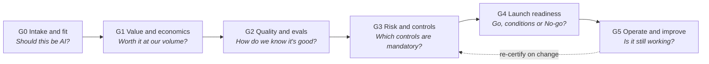
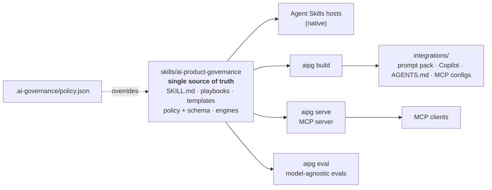

# AI Product Governance

**Install:** `npx skills add joydeep195/ai-product-governance` (needs Node.js 18+ and Git). Other tools, and fixes
if `npx` fails: [installation guide](docs/install.md).

**Ship AI features that are worth building, measurably good, controlled in proportion to their risk, and safe to
operate, in whichever AI tool your teams use.**

[](https://github.com/joydeep195/ai-product-governance/actions/workflows/ci.yml)
[](https://agentskills.io)
[](integrations/mcp/)
[](pyproject.toml)
[](LICENSE)

AI Product Governance turns an AI assistant into a rigorous enterprise AI product lead. It packages one governance
method as an [open Agent Skill](https://agentskills.io), a policy-as-code engine and an MCP server, so ChatGPT,
GitHub Copilot, Claude, Cursor, Gemini and Codex all apply the **same rules, the same risk tiers and the same
numbers**.

---

## Why it exists

Most AI features that disappoint fail in predictable ways:

| Failure | What this enforces instead |
|---|---|
| An LLM is used where rules or search would do | **Earn the model:** a six-dimension AI fit test before any spec |
| "It looked great in the demo" | **Define good before build:** golden sets, thresholds, a baseline to beat, critical criteria that block launch |
| Costs quoted per token | **Price the completed task:** model cost + review time + the cost of fixing failures, with break-even |
| The same rigour for an internal summariser and a credit decision | **Controls scale with risk:** policy-defined tiers, rules, controls and approvers |
| "Let the agent just do it" | **Autonomy is earned:** an L0-L5 ladder with evidence required to move up |
| "The model got worse, let's switch vendors" | **Diagnose before you switch:** an ordered regression protocol |

## The method: six gates



Each gate has a playbook, exit criteria and an artifact template: use-case brief, business case, eval plan, risk
assessment, launch readiness review, incident review, AI PRD and model decision record.

## Works with your AI tools

| Tool | How |
|---|---|
| Claude Code, Claude apps, OpenAI Codex, GitHub Copilot (VS Code, CLI, cloud agent), Cursor, Gemini CLI and other [Agent Skills](https://agentskills.io) hosts | Install the skill natively (below) |
| ChatGPT Business, Enterprise or Edu (Skills) | Upload the skill zip from the [latest release](https://github.com/joydeep195/ai-product-governance/releases) |
| ChatGPT custom GPTs and Projects, Gemini Gems, Microsoft 365 Copilot agents, Claude Projects, any LLM API | [Prompt pack](integrations/prompt-pack/): instructions under 8,000 characters plus knowledge files |
| GitHub Copilot slash commands | [Prompt files](integrations/github-copilot/), one per workflow (`/ai-prd`, `/ai-risk-review`, …) |
| Any MCP client (Claude Desktop, VS Code, Cursor, Gemini CLI, Codex, ChatGPT connectors) | [MCP server](integrations/mcp/) with read-only tools, prompts and resources |
| Agents that read `AGENTS.md` | [AGENTS.md section](integrations/agents-md/) |

### One tool is enough

Every feature works with whichever single AI tool you already use. You never need a second tool, a second
sign-in or an API key.

| Feature | Agentic tools (Claude Code, Codex, Copilot, Cursor, Gemini CLI) | Chat tools (ChatGPT, Gemini, Microsoft 365 Copilot, Claude apps) |
|---|---|---|
| Governance method: rules, six gates, playbooks, templates | The skill, loaded natively | The skill where supported, otherwise the prompt pack |
| Policy as code: your organisation's tiers, controls and approvers | `.ai-governance/policy.json` in the repo | Upload your policy file with the prompt pack |
| Deterministic calculators: risk tier, unit economics | The bundled Python scripts | Code execution where the tool has it, the MCP server, or the documented formulas |
| Evals: does the skill improve answers? | `aipg eval` detects your tool and uses it to answer and to grade | `aipg eval-kit`: copy-and-paste steps, scored offline |

## Quick start

Full per-tool instructions: **[docs/install.md](docs/install.md)**.

**Any coding tool** (Claude Code, Codex, GitHub Copilot, Cursor, Gemini CLI, Windsurf and more):

```bash
npx skills add joydeep195/ai-product-governance
```

No Node.js? Copy the `skills/ai-product-governance/` folder into your tool's skills folder, for example
`.agents/skills/` in your repository (Codex, Copilot, Cursor, Gemini CLI) or `.claude/skills/` (Claude Code).

**Claude Code plugin:**

```text
/plugin marketplace add joydeep195/ai-product-governance
/plugin install ai-product-governance@aipg
```

**MCP server** (requires [uv](https://docs.astral.sh/uv/)):

```bash
uvx --from git+https://github.com/joydeep195/ai-product-governance aipg serve
```

Then ask your assistant what you would ask a senior AI product lead:

> *"Our CEO wants us to add AI to the support platform this quarter. Write the PRD."*
> *"Product wants an agent that issues refunds up to $500 with no human in the loop. Can you approve it?"*
> *"Acceptance of our AI replies dropped from 62% to 48%. Should we switch providers?"*

## Policy as code

Tiers, rules, controls, approvers and launch thresholds live in a validated JSON policy, not in prompts. Drop
`.ai-governance/policy.json` into a repository, or point the MCP server at one, and every assistant applies your
organisation's rules. See the [policy guide](docs/policy.md) and an
[example bank policy](examples/financial-services/.ai-governance/policy.json).

```console
$ python skills/ai-product-governance/scripts/risk_tier.py --answers examples/inputs/refund-agent.answers.json --format md
**Risk tier: High** | Policy: aipg-default v1.0.0 (bundled default policy)

| Rule | Tier | Reason |
|---|---|---|
| H-06 | high | Acts without per-action approval in a way that affects customers or cannot easily be reversed. |
| L-01 | limited | People outside the organisation see the output or interact with the AI. |
...
**Autonomy:** planned L4; maximum at launch L3.
> Planned autonomy L4 exceeds the launch cap L3 for the High tier. Launch at L3 or lower and promote with evidence.
```

## Arithmetic in code, judgement in prose

Language models are unreliable at multi-step arithmetic, so the skill ships deterministic calculators
(Python 3.9+, standard library only, so they run in code interpreters too) and tells models never to estimate.

```console
$ python skills/ai-product-governance/scripts/unit_economics.py --input examples/inputs/support-reply-drafting.economics.json --format md
| Model cost per call | 0.0300 USD |
| **Cost per completed task** | **2.5567 USD** |
| Baseline cost per task | 5.3333 USD |
| Monthly net benefit | 108,065.33 USD |
| Break-even success rate | 23.7% |
> Human review and failure handling are more than half the cost per completed task; raising the success rate
> or cutting review time is worth more than a cheaper model.
```

## Architecture



- **Standards first:** the canonical package follows the Agent Skills specification; adapters exist only where a
  tool lacks native support, and they are generated, committed and drift-checked in CI.
- **Read-only by design:** MCP tools are side-effect free and the policy is fixed at server start, so a
  prompt-injected model cannot change the rules.
- **Decisions are recorded:** seven [architecture decision records](docs/adr/) explain the trade-offs.

Full details: [docs/architecture.md](docs/architecture.md).

## Quality engineering

| Check | What it guarantees |
|---|---|
| 127 unit and integration tests on Linux, Windows and macOS, Python 3.11-3.14 | Engines, MCP server, adapters and eval harness behave as specified |
| Bundled scripts tested on Python 3.9 | They run in code-interpreter sandboxes |
| `ruff`, `ruff format`, `mypy --strict` | Clean, consistently typed code |
| `aipg validate --strict` | Agent Skills spec compliance, policy schema, links, version consistency, size budgets |
| `aipg build --check` | Every integration matches the skill |
| Wheel smoke test in a clean environment | The packaged skill and MCP server work outside the repository |
| `aipg eval` (scheduled and on demand) | Behavioural quality across models, with and without the skill, gated against a baseline |

### Tool-independent evals

Ten scenarios cover every gate and the classic failure modes: fabricated numbers, AI where rules suffice, launch
pressure, autonomous money movement, premature model switching and legal overreach. Each runs **with** the skill
and **without** it, graded blind against a rubric plus deterministic checks, with critical criteria that fail a
trial outright. See the [evaluation methodology](docs/evaluation.md).

Use whatever you have; one tool does both the answering and the grading:

```bash
aipg eval --dry-run        # shows which AI access was detected: Claude Code, Codex, Gemini CLI, Copilot CLI,
                           # Cursor, an API key, or a local model (Ollama/LM Studio)
aipg eval --trials 1       # runs the suite with the first one that is ready

aipg eval-kit create       # chat-only tool (ChatGPT, Gemini, M365 Copilot)? copy-and-paste kit, scored offline
```

## Development

```bash
python -m venv .venv && source .venv/bin/activate   # Windows: .venv\Scripts\activate
pip install -e ".[dev]"
python -m pytest && aipg validate --strict && aipg build --check
```

See [CONTRIBUTING.md](CONTRIBUTING.md). Security reports: [SECURITY.md](SECURITY.md).

## Scope and disclaimer

This project helps teams make and document AI product decisions. The default policy is informed by the EU AI Act
risk categories and the NIST AI RMF, but it is **not legal advice** and does not replace legal, privacy, security or
compliance review.

## License

[MIT](LICENSE)
