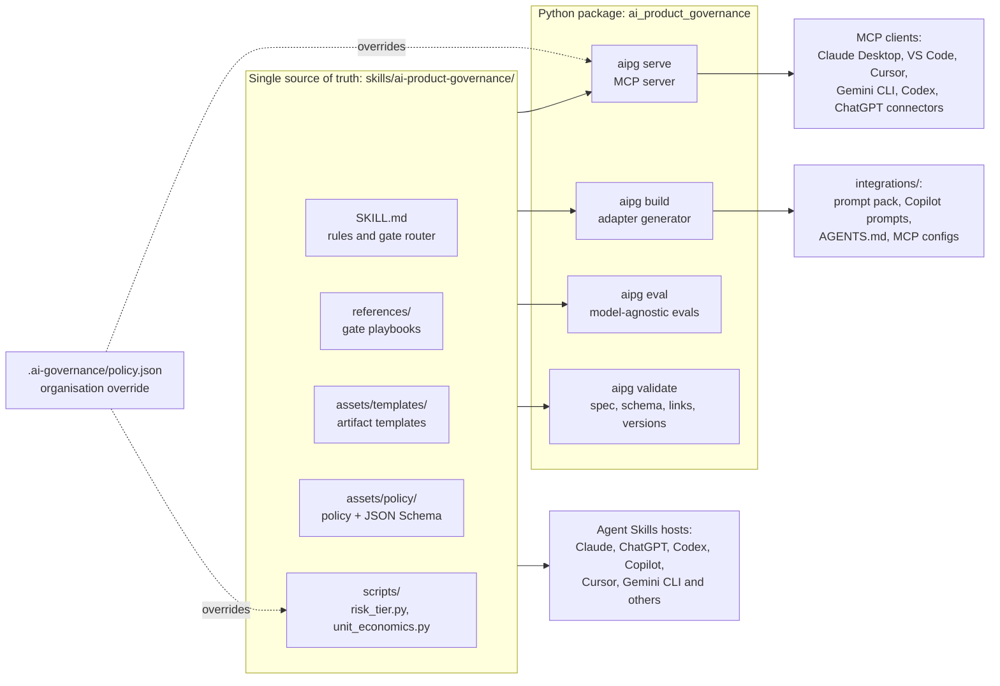
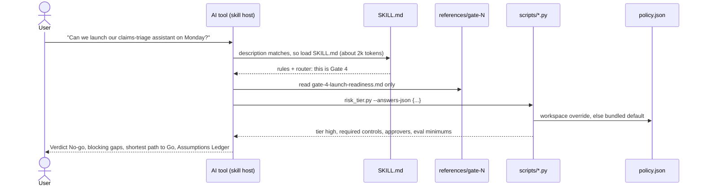

# Architecture

## Design goals

1. **One governance method, every AI tool, and one tool is enough.** The same rules, gates, policy and
   calculations whether someone works in ChatGPT, GitHub Copilot, Claude, Cursor, Gemini or a custom app, with no
   feature requiring a second tool, a second sign-in or an API key.
2. **Standards first.** Build on open standards (Agent Skills, MCP, JSON Schema) rather than any one vendor's
   format, so portability is the default and adapters are the exception.
3. **Judgement in prose, arithmetic in code.** Models handle reasoning and writing; deterministic engines handle
   anything that must be repeatable or auditable.
4. **Configurable without forking.** Organisations change tiers, rules, controls and approvers in a policy file,
   not in code or prompts.
5. **Measured, not asserted.** Behavioural quality is evaluated across models and gated in CI.

## Components



| Component | Responsibility | Key decisions |
|---|---|---|
| Skill (`skills/ai-product-governance/`) | The governance method: rules, routing, playbooks, templates, policy, engines | [ADR 0001](adr/0001-agent-skills-as-canonical-source.md), [ADR 0003](adr/0003-deterministic-engines-in-the-skill.md) |
| Policy (`assets/policy/`) | Tiers, rules, controls, approvers, eval minimums as validated data | [ADR 0002](adr/0002-policy-as-code.md) |
| Adapter generator (`adapters.py`) | Renders tool-specific integrations; CI rejects drift | [ADR 0006](adr/0006-generated-integrations.md) |
| MCP server (`mcp_server.py`) | Read-only tools, prompts and resources; central policy enforcement | [ADR 0004](adr/0004-mcp-for-central-enforcement.md) |
| Eval harness (`evals/`) | Same scenarios with and without the skill, on whichever single AI tool the user has | [ADR 0005](adr/0005-model-agnostic-evals.md), [ADR 0007](adr/0007-one-tool-is-enough.md) |
| Validator (`validate.py`) | Agent Skills spec, schema, links, version consistency, size budgets | — |

## How a request flows (skill-native tools)



Progressive disclosure keeps context small: about 100 tokens of metadata always, the SKILL.md body only when the
skill activates, and one playbook per gate on demand.

## Repository layout

```text
skills/ai-product-governance/   canonical skill (the product)
  SKILL.md                      rules, lifecycle router, output standards
  references/                   gate playbooks, approach and model selection, glossary
  assets/templates/             eight artifact templates
  assets/policy/                default policy and JSON Schema
  scripts/                      deterministic engines (Python 3.9+, stdlib only)
src/ai_product_governance/      toolkit: CLI, MCP server, adapters, validator, evals
integrations/                   generated adapters (do not edit)
evals/                          eval config, scenarios, baselines
examples/                       example organisation policy and inputs
docs/                           architecture, evaluation, policy guide, ADRs
.claude-plugin/                 Claude Code plugin and marketplace manifests
.github/                        CI, evals, release, Dependabot, templates
```

## Quality gates

| Gate | Where | Catches |
|---|---|---|
| `ruff check`, `ruff format --check`, `mypy --strict` | CI | Code defects, style drift, type errors |
| `aipg validate --strict` | CI | Spec violations, broken links, invalid policies, version mismatch, oversize prompt pack |
| `aipg build --check` | CI | Generated integrations out of step with the skill |
| `pytest` on 3 OSes and Python 3.11-3.14 | CI | Engine, server, adapter and harness regressions |
| Bundled scripts on Python 3.9 | CI | Code-interpreter compatibility |
| Wheel smoke test | CI | Packaging mistakes (for example a skill missing from the wheel) |
| `aipg eval` with gates and baseline comparison | Scheduled, manual, or `run-evals` label | Behavioural regressions across models |
